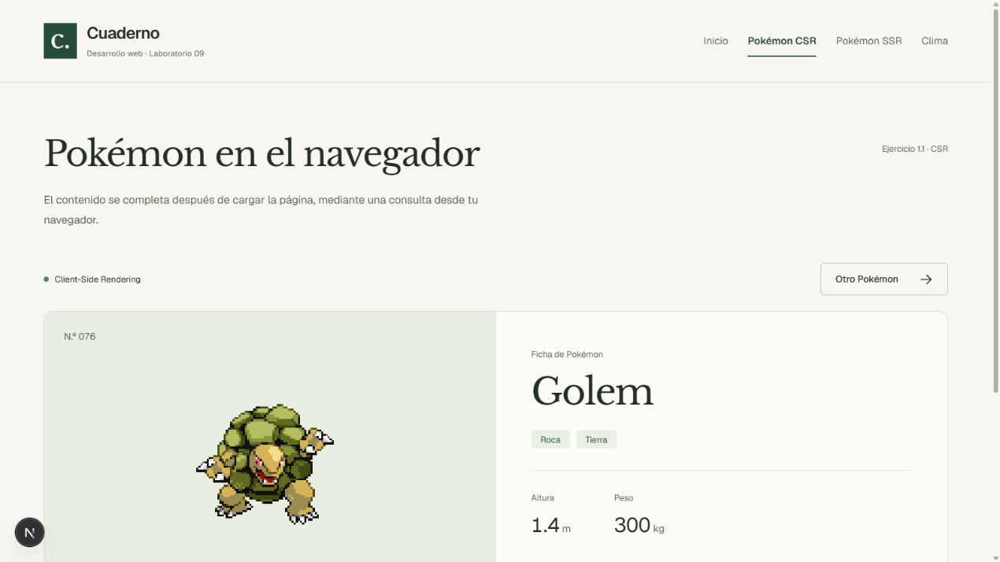
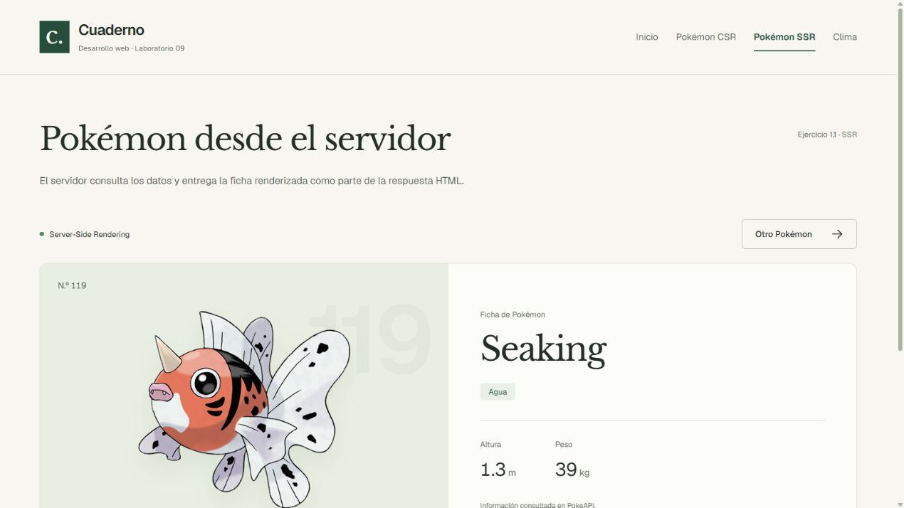
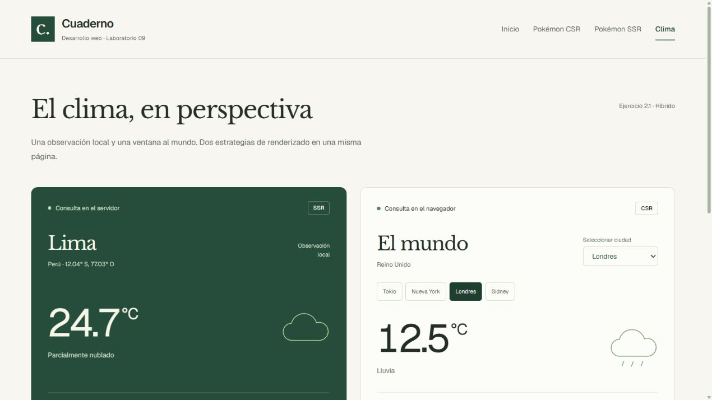
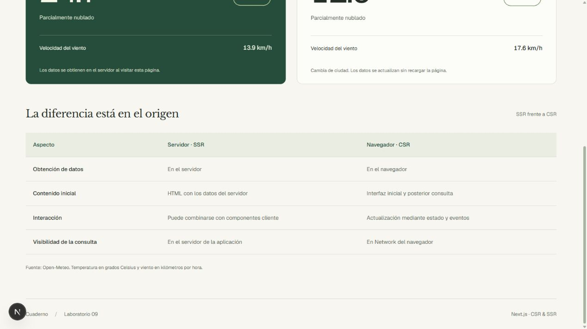

# Laboratorio 09 — CSR y SSR

Alcance: ejercicios 1.1 (PokeApp) y 2.1 (dashboard híbrido). La tarea integradora se documenta por separado en tarea-cine.md y utiliza TMDB por indicación del usuario.

## Ejecutar

```sh
npm install
npm run dev
```

- Inicio: http://localhost:3000
- Pokémon CSR: http://localhost:3000/pokemon-csr
- Pokémon SSR: http://localhost:3000/pokemon-ssr
- Clima: http://localhost:3000/weather

## Cuándo aparece el contenido

Pokémon CSR: primero aparece «Cargando Pokémon…». useEffect consulta PokeAPI con Axios después de montar el componente en el navegador y actualiza el estado.

Pokémon SSR: el servidor consulta PokeAPI y envía el Pokémon como HTML. Esta versión de Next.js permite enviar primero el fallback de Suspense y después el HTML con los datos. SSR no implica que nunca se muestre un estado de espera. Se usa connection() para obtener un Pokémon al recibir una visita en lugar de fijarlo durante la compilación.

Clima: Lima se obtiene en el servidor. El widget del mundo inicia con Tokyo y obtiene sus datos en el navegador. Cambiar la ciudad actualiza ese widget sin recargar la página ni volver a consultar Lima.

## Peticiones de datos

Conteos lógicos esperados por carga, sin contar HTML, JavaScript, estilos, imágenes, herramientas de desarrollo ni precarga de rutas:

| Página | Desde el navegador a la API | Desde el servidor a la API |
| --- | --- | --- |
| Pokémon CSR | 1 a PokeAPI | 0 |
| Pokémon SSR | 0 a PokeAPI | 1 a PokeAPI |
| Clima | 1 a Open-Meteo para la ciudad seleccionada | 1 a Open-Meteo para Lima |
| Cambio de ciudad | 1 adicional a Open-Meteo | 0 |

En desarrollo, React Strict Mode puede iniciar un efecto adicional; su petición se cancela al limpiar el efecto. Por ello Network puede mostrar una petición cancelada y una completada. El total de solicitudes de la página depende también de caché, imágenes y recursos de Next.js. Estos conteos describen las consultas del código; no son un conteo total medido en DevTools.

Para comprobarlo: abrir DevTools → Network, filtrar Fetch/XHR, limpiar el registro y recargar. En CSR aparece la consulta a la API; en SSR la consulta externa ocurre en el servidor y no aparece como Fetch/XHR del navegador. Consultar el código fuente o la respuesta HTML permite comprobar el contenido SSR.

## Verificaciones realizadas

- npm run lint: sin errores ni advertencias.
- npm run build: compilación y TypeScript correctos. SSR y clima contienen contenido dinámico del servidor.
- Navegador: Pokémon CSR mostró primero carga y luego Golem; el botón Otro Pokémon cambió la ficha a Kingler sin recargar. SSR mostró la ficha obtenida en el servidor.
- Respuesta HTTP: CSR contenía el estado de consulta y no contenía la URL del sprite; SSR sí contenía la URL del sprite.
- Navegador: dashboard mostró Lima y Tokyo; cambiar a London actualizó el clima del mundo sin recargar (Lima permaneció visible).

Las temperaturas y Pokémon son datos variables; las capturas registran una ejecución concreta.

## Capturas






La tabla compara el origen de los datos, el contenido inicial, la interacción y la visibilidad de las consultas. Una página SSR puede incluir componentes cliente interactivos, como demuestra este dashboard.
