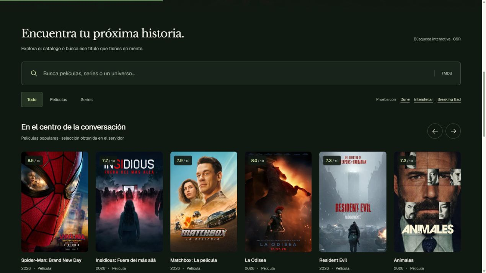
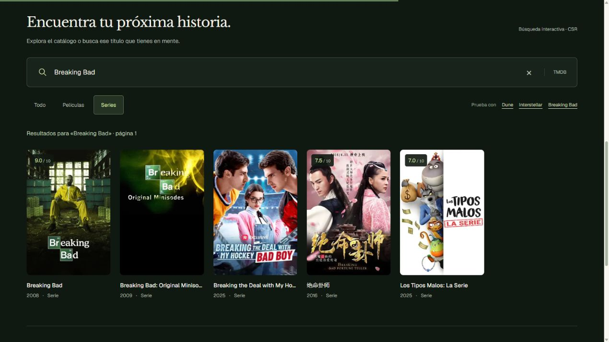
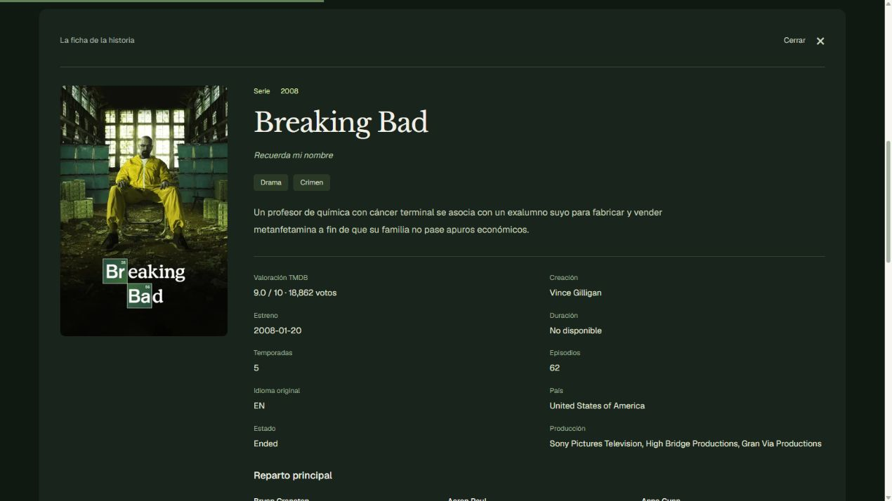

# Tarea integradora — Cuaderno cinema

## Alcance y servicio

Galería de películas y series en `/cine`, dentro del mismo proyecto, con identidad cinematográfica propia. Se emplea TMDB por indicación del usuario; la guía original propone OMDb. Se conservan los requisitos funcionales: listado SSR, búsqueda CSR sin recargar, detalles de películas y series, async/await, useState, useEffect, diseño adaptable y justificación del renderizado.

## Configuración

Copiar `.env.example` a `.env.local` y completar `TMDB_API_KEY` con una clave válida de TMDB. Reiniciar Next.js después de cambiarla. No usar `NEXT_PUBLIC_`. `.env.local` está excluido por `.gitignore`; el archivo de ejemplo no contiene credenciales.

La clave se usa únicamente en `app/lib/tmdb.ts`, módulo protegido con `server-only`. El navegador consulta `/api/cine`; la URL pública no incluye credenciales. No se usa ninguna otra clave.

## Requisitos y evidencia

| Requisito | Implementación |
| --- | --- |
| Página principal SSR | `app/cine/page.tsx` espera la visita con connection() y obtiene películas populares, series y películas mejor valoradas en el servidor. Los títulos y sus fichas resumidas están presentes en el HTML. |
| Búsqueda CSR | `app/cine/Cinema.tsx` lleva use client y usa useState/useEffect. La búsqueda tiene espera de 450 ms, cancelación de peticiones anteriores, filtros y paginación. |
| Sin recargar | Las búsquedas y los detalles usan Axios contra `/api/cine`. |
| Detalle en la misma página | Panel con sinopsis, géneros, duración, dirección o creación, reparto, valoraciones, estreno, idioma, países, producción, presupuesto/recaudación o temporadas/episodios. Puede cerrarse y reintentarse. |
| Diseño con Tailwind | Tailwind sigue integrado en el proyecto y se usa para utilidades de accesibilidad; el apartado amplía el sistema con CSS propio, componentes y variables. |
| async/await | Consultas del servidor, búsqueda cliente y carga del detalle. |
| Estados | Carga, resultados vacíos, errores recuperables, póster ausente y botones de paginación deshabilitados. |
| Diseño propio | Verde nocturno, marfil, acento salvia, tipografía editorial, portada con imagen, carruseles y fichas. |

## Por qué SSR y CSR

SSR permite entregar los títulos populares como HTML sin esperar a una consulta del navegador. connection() hace que el contenido se resuelva durante la visita; Suspense permite enviar una interfaz de espera mientras el servidor consulta el catálogo.

CSR conviene para buscar mientras se escribe, filtrar, avanzar páginas y abrir detalles sin recargar. El estado del componente determina qué resultados aparecen. Usar un endpoint interno no cambia esta estrategia: el navegador sigue iniciando la petición y actualizando la interfaz; el servidor intermediario mantiene privada la clave.

La caché de respuestas del servidor dura 15 minutos, tiene un máximo de 128 entradas y no guarda errores. Las fichas abiertas se reutilizan en memoria durante la sesión del componente. No se inventan películas, valoraciones ni pósteres.

## Pruebas en el navegador

1. Abrir `/cine` y comprobar las filas iniciales. En la respuesta HTML aparecen los títulos populares.
2. DevTools → Network → Fetch/XHR, limpiar registro y escribir `Interstellar`. Se observa `/api/cine?q=…`; no aparece la clave ni una consulta directa del cliente a TMDB.
3. Abrir la ficha de Interstellar: se consulta `/api/cine?id=157336&kind=movie`; aparecen dirección, reparto y duración sin navegación.
4. Buscar `Breaking Bad` con el filtro Series; abrir la ficha y comprobar temporadas y episodios.
5. Buscar un texto inexistente y verificar el estado sin resultados. Limpiar para volver al catálogo.
6. Cambiar entre tipos y páginas; comprobar los controles de desplazamiento de cada fila y la navegación por teclado.

En desarrollo puede aparecer una solicitud cancelada adicional debido a Strict Mode. El número de peticiones depende de búsquedas, filtros, páginas, detalles abiertos y caché; no debe confundirse con todos los recursos de la página.

## Cinco conclusiones

1. SSR es adecuado para el catálogo inicial porque los títulos llegan preparados en HTML y pueden leerse antes de completar la interacción cliente.
2. CSR facilita la búsqueda y los detalles en la misma página, manteniendo los controles disponibles sin recargar.
3. Una interfaz híbrida permite combinar el contenido inicial del servidor con actualizaciones dirigidas por el estado del navegador.
4. Mantener las credenciales en el servidor y excluir los archivos de entorno permite publicar el código sin publicar la clave.
5. Las transiciones breves, la cancelación de consultas y los estados de error y vacío ayudan a que el catálogo sea comprensible también cuando la red tarda o falla.

## Repositorio

https://github.com/luisdionicio-lgtm/LABO09_WEB_AVANZADO

## Referencias

- https://developer.themoviedb.org/reference/movie-popular-list
- https://developer.themoviedb.org/reference/search-multi
- https://developer.themoviedb.org/docs/image-basics
- https://developer.themoviedb.org/docs/faq

## Verificaciones realizadas

- `npm run lint` y `npm run build`: correctos.
- La respuesta HTML de `/cine` incluye películas populares y no contiene la clave.
- No se encontró la clave en los archivos estáticos enviados al navegador.
- Búsqueda real de Interstellar, ficha de Christopher Nolan con 169 minutos y 12 integrantes del reparto.
- Búsqueda real de Breaking Bad, ficha con cinco temporadas, 62 episodios y creador Vince Gilligan.
- Consulta inexistente: lista vacía; identificador inválido: HTTP 400.
- `.env.local` está ignorado por Git. `.env.example` contiene únicamente el nombre de la variable.

## Capturas

